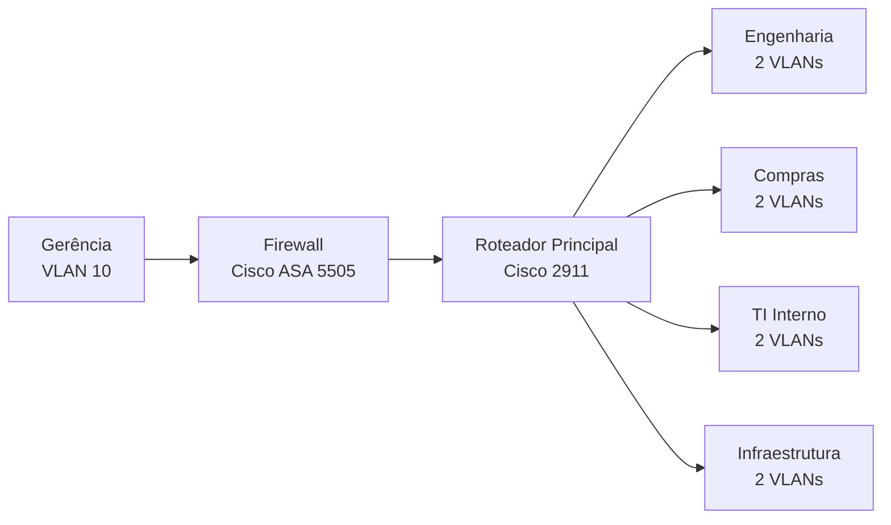

# 🛡️ Rede Empresarial Segmentada

### VLANs • ACLs • Firewall Cisco ASA 5505

Infraestrutura de rede corporativa simulada no **Cisco Packet Tracer**, com foco em segmentação de redes, controle de acesso e segurança da informação.


---

## 📌 Sobre o projeto

Este projeto consiste na implementação de uma infraestrutura de rede empresarial utilizando o **Cisco Packet Tracer**, simulando uma organização dividida em diferentes departamentos.

A rede foi planejada com segmentação por VLANs, permitindo organizar os dispositivos de acordo com suas respectivas áreas. O controle da comunicação entre as redes é realizado por meio de ACLs, enquanto um firewall Cisco ASA 5505 foi implementado para integrar a área de Gerência à infraestrutura principal.

O objetivo é aplicar conceitos de redes de computadores e segurança da informação em um ambiente corporativo simulado.

## 🎯 Objetivos

- [x] Desenvolver uma infraestrutura de rede empresarial.
- [x] Dividir os departamentos utilizando VLANs.
- [x] Configurar endereçamento IPv4 e sub-redes.
- [x] Implementar roteamento entre VLANs.
- [x] Configurar ACLs para controlar o tráfego entre redes.
- [x] Implementar o firewall Cisco ASA 5505.
- [x] Criar uma rede exclusiva para a Gerência.
- [x] Realizar testes de conectividade e isolamento entre VLANs.

## 🗺️ Topologia

A infraestrutura utiliza um roteador principal Cisco 2911, switches para distribuição dos dispositivos e um firewall Cisco ASA 5505 para integrar a rede de Gerência.


**Representação lógica simplificada:**



## 🏢 Estrutura da rede

A empresa foi dividida em cinco áreas:

| Departamento | Segmentação |
|---|---|
| 🔧 Engenharia | 2 VLANs |
| 🛒 Compras | 2 VLANs |
| 💻 TI Interno | 2 VLANs |
| 🏗️ Infraestrutura | 2 VLANs |
| 👔 Gerência | VLAN 10 |

Cada VLAN dos departamentos possui computadores, um servidor e uma impressora.

A área de Gerência possui computadores e um servidor próprio, além de acesso às demais redes por meio da infraestrutura de firewall e roteamento.

## 🖥️ Equipamentos

| Equipamento | Função |
|---|---|
| Cisco Router 2911 | Roteamento entre VLANs |
| Cisco ASA 5505 | Firewall e controle de tráfego |
| Switches Cisco | Distribuição e segmentação da rede |
| Computadores | Estações de trabalho |
| Servidores | Recursos e serviços internos |
| Impressoras | Dispositivos de impressão em rede |

## 🌐 Endereçamento IP

As redes dos departamentos utilizam máscara `/28`, permitindo até 14 endereços IP utilizáveis por sub-rede.

| VLAN | Rede | Gateway |
|---|---|---|
| VLAN 2 | 192.168.0.0/28 | 192.168.0.1 |
| VLAN 3 | 192.168.0.16/28 | 192.168.0.17 |
| VLAN 4 | 192.168.0.32/28 | 192.168.0.33 |
| VLAN 5 | 192.168.0.48/28 | 192.168.0.49 |
| VLAN 6 | 192.168.0.64/28 | 192.168.0.65 |
| VLAN 7 | 192.168.0.80/28 | 192.168.0.81 |
| VLAN 8 | 192.168.0.96/28 | 192.168.0.97 |
| VLAN 9 | 192.168.0.112/28 | 192.168.0.113 |
| VLAN 10 | 192.168.0.128/28 | 192.168.0.142 |

**Informações adicionais:**

- Máscara das sub-redes: `255.255.255.240`
- Prefixo: `/28`
- Gateway da Gerência: `192.168.0.142`
- Interface interna do firewall: `192.168.0.142`
- Interface externa do firewall: `192.168.1.1`
- Endereço do roteador na conexão com o firewall: `192.168.1.2`

## 🧠 Tecnologias e conceitos

- **VLAN:** segmentação lógica da rede.
- **IPv4:** endereçamento dos dispositivos.
- **Subnetting:** divisão de redes em sub-redes menores.
- **Máscara /28:** planejamento do espaço de endereçamento.
- **Inter-VLAN Routing:** comunicação entre diferentes VLANs.
- **ACLs:** controle de acesso e filtragem de tráfego.
- **Firewall:** proteção e controle de comunicação entre redes.
- **ICMP:** testes de conectividade utilizando Ping.

## 🔐 Segurança e controle de acesso

Foram implementadas ACLs no roteador Cisco 2911 para controlar a comunicação entre as VLANs.

As regras foram planejadas para:

- ✅ Permitir a comunicação dentro da própria VLAN.
- ⛔ Restringir a comunicação entre redes não autorizadas.
- 🔐 Permitir o acesso das redes dos departamentos à rede de Gerência, conforme as regras configuradas.
- 👔 Disponibilizar à Gerência acesso às demais redes por meio da infraestrutura de firewall e roteamento.

O firewall Cisco ASA 5505 foi utilizado para integrar a rede de Gerência à infraestrutura principal.

## ✅ Testes realizados

Foram realizados testes de conectividade utilizando o comando `ping` no Prompt de Comando dos computadores.

| Origem → Destino | Resultado esperado | Resultado obtido |
|---|---|---|
| Gerência → Gateway do ASA | Permitido | ✅ Aprovado |
| Gerência → Servidor da Gerência | Permitido | ✅ Aprovado |
| Gerência → VLAN 2 | Permitido | ✅ Aprovado |
| Gerência → VLAN 3 | Permitido | ✅ Aprovado |
| VLAN 2 → VLAN 3 | Bloqueado | ⛔ Bloqueado |

Os resultados demonstram o funcionamento da conectividade e das regras de isolamento nos cenários avaliados.

**Observação:** os testes apresentados correspondem aos cenários efetivamente validados. Outras combinações de comunicação entre VLANs ainda podem ser testadas.

## 🚀 Como abrir o projeto

1. Instale o [Cisco Packet Tracer](https://www.netacad.com/).
2. Clone este repositório:

```bash
git clone https://github.com/PedroShiokawaSilva/rede-empresarial-cisco-packet-tracer.git
```

3. Entre na pasta do projeto.
4. Abra o arquivo `.pkt` utilizando o Cisco Packet Tracer.
5. Explore a topologia e execute os testes de conectividade.

## 📚 Aprendizados

Durante o desenvolvimento deste projeto, foram aplicados conhecimentos relacionados a:

- Planejamento de redes IPv4 e sub-redes.
- Segmentação de redes utilizando VLANs.
- Configuração de switches e roteadores Cisco.
- Roteamento entre VLANs.
- Criação e aplicação de ACLs.
- Configuração de firewall Cisco ASA 5505.
- Testes de conectividade e isolamento de redes.
- Resolução de problemas de comunicação entre dispositivos.

## 👨‍💻 Autor

Projeto desenvolvido por **Pedro Shiokawa Silva**, estudante de Ciências da Computação, com o objetivo de desenvolver conhecimentos práticos em infraestrutura de redes, administração de redes e segurança cibernética.


**Pedro Shiokawa Silva**

[GitHub](https://github.com/PedroShiokawaSilva) • [Repositório do Projeto](https://github.com/PedroShiokawaSilva/rede-empresarial-cisco-packet-tracer)

